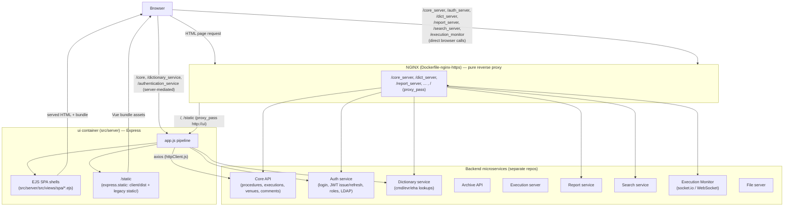
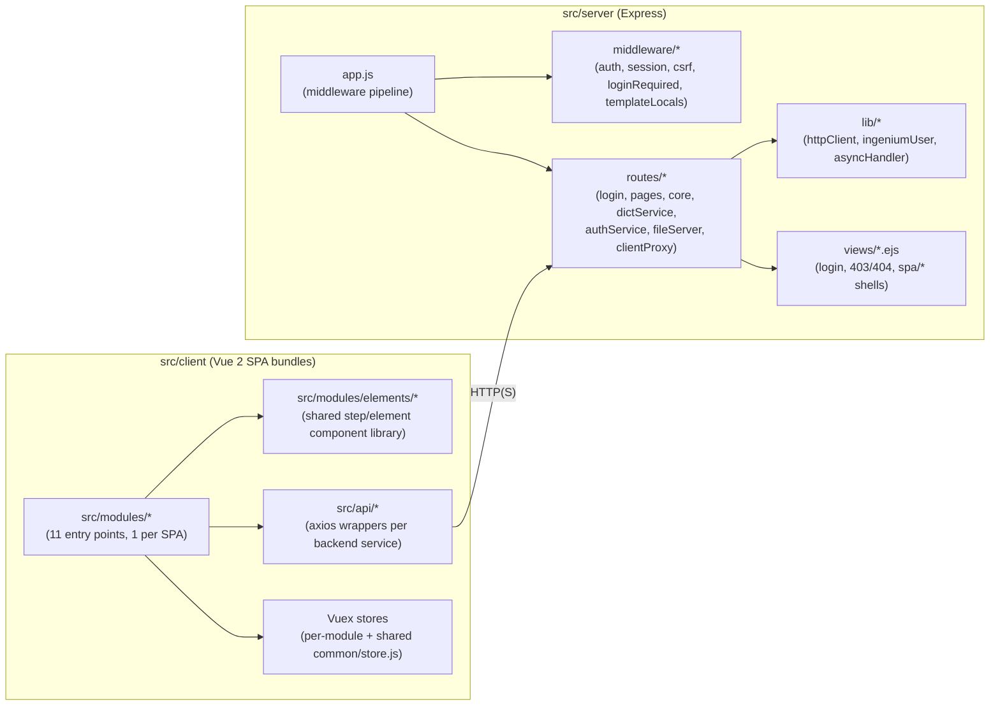
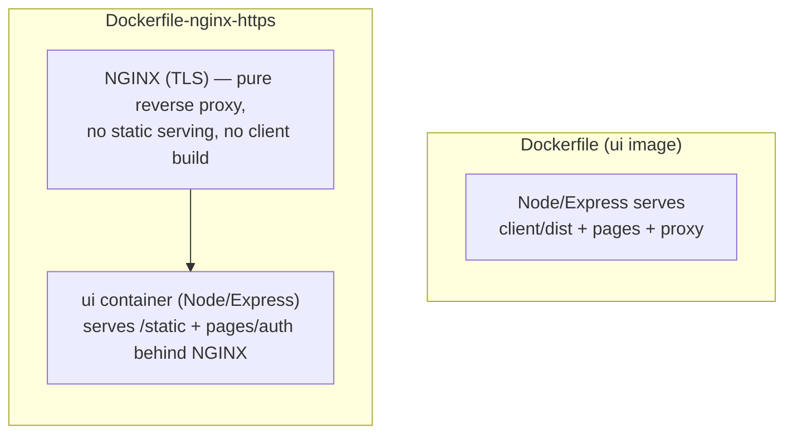
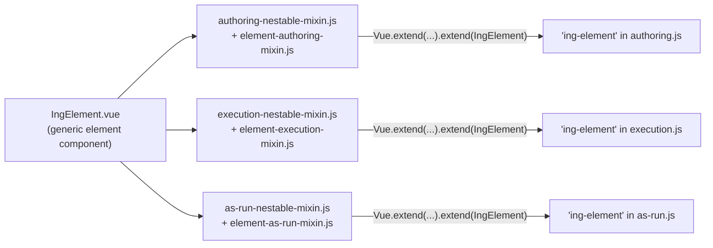
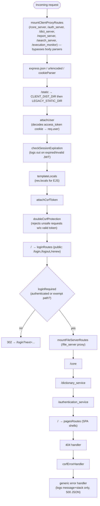

# Architecture

[← Home](Home.md)

## Big picture

Ingenium UI is a **backend-for-frontend (BFF) style Node/Express server** fronting a
**multi-bundle Vue 2 single-page application**. In production, an NGINX layer sits in front of
both, doing TLS termination and reverse-proxying to a constellation of backend microservices
that live in other repositories. NGINX itself serves no files — all pages and static assets
(`/static`) are served by the `ui` (Node/Express) container, which NGINX proxies everything to.

**Key fact (observed):** the client calls backend services **two different ways**:

1. **Server-mediated** — a small set of calls go to the `ui` server's own routes
   (`/core`, `/dictionary_service`, `/authentication_service`), which
   attach the user's Bearer token and forward the request via
   `src/server/src/lib/httpClient.js`. See
   `src/server/src/routes/core.js`,
   `dictService.js`, `authService.js`.
2. **Direct browser calls** — most client API modules
   (`src/client/src/api/*.js`) call path prefixes like
   `/core_server/api/v5/...` directly from the browser. In production these are resolved by
   NGINX (`ingenium-https.conf` `location /core_server/ { proxy_pass ...; }`); in local dev
   (no NGINX in front of the Node server) they are resolved by
   `src/server/src/routes/clientProxy.js`, which mounts
   equivalent reverse proxies inside the Express app so the browser sees the same URL space
   either way.

## Why a Node server exists at all (inferred from code comments)

Numerous source comments (e.g.
`src/server/src/app.js:39-44`,
`src/server/src/config/index.js:1-2`,
`src/server/package.json:3`) state that this Express
server **replaces a previous Django/gunicorn server**. The middleware, routes, and config
module are explicitly described as ports of specific Django modules (e.g.
`ingenium_user_middleware.py`, `ingenium_session_middleware.py`,
`ingenium_login_middleware.py`, `context_processors/__init__.py`). This is **observed
implementation** (stated directly in comments), not speculation. The old Django app itself
(`src/ingenium/`, `src/apps/`, `config/requirements.txt`) no longer exists in this repository —
only the migration-comment trail in `src/server` documents that it once did. The top-level
[`README.md`](../../README.md) documents the current Node/Express setup; see
[Development](Development.md) for the practical walkthrough.

The Django replacement is intentionally **partial**: it does not reintroduce a database. The
"user" in this system (`IngeniumUser`, see
`src/server/src/lib/ingeniumUser.js`) is derived
entirely from the JWT stored in the `access_token` cookie — there is no session store or user
table in this repository.

## Component map

## Deployment topologies (observed from Dockerfiles)

The repo defines **three build targets**, reflecting different deployment shapes:

- `Dockerfile` — builds the client
  (`npm run build:single-node`) and packages it with the Node/Express server into one `ui`
  image. This is the image whose server (`src/server`) implements auth/CSRF/proxying itself
  (used when there is **no** NGINX in front, e.g. local single-node dev).
- `Dockerfile-nginx-https` — the "full" production
  shape: NGINX terminates TLS (`ingenium-https.conf`) and reverse-proxies **everything**,
  including `/static`, straight to the `ui` container (`upstream ui { server ui:5000; }`) plus
  the named backend upstream containers (`core_server`, `dict_server`, `auth_service`, ...)
  defined by a Docker Compose stack that is **not part of this repository** — its exact
  location/name is not established by anything checked into this repo (see the "Unknown" note
  below). This image does **not** build the client or serve any files itself — it is a pure
  reverse proxy, since the `ui` container already serves `/static` via `express.static`.

**Unknown / not documented:** the exact orchestration (which containers run together, in what
compose file, under what repository name) is not part of this repo and was not established by
anything in it — the `.env.example` files describe the individual service URLs a working
deployment needs, but not how those services are themselves built/deployed/orchestrated.

## Client architecture: multiple SPAs, one component library

The client is **not one SPA** — `webpack.config.js` defines 11 independent entry
bundles (`dashboard`, `execution`, `executions`, `authoring`, `execute-as-run`, `venue-detail`,
`project-config`, `reporting`, `header`, `admin`, `search`), each mounted into a different EJS
page shell served by `src/server/src/routes/pages.js`.
See [Client](Client.md#module-bundles) for the full mapping.

The **authoring** and **execution** bundles both render procedures as a tree of "element"
components, but the same Vue components are reused across contexts (authoring vs. live
execution vs. as-run playback) via **mode-specific mixins** rather than being duplicated:

This pattern (`Vue.extend(mixin).extend(Component)`, then registered globally with
`Vue.component('ing-element', ...)`) repeats for every step/element type
(`cmd-element`, `wait-eha-element`, `custom-script-element`, ...) in each of
`src/client/src/modules/authoring/authoring.js`,
`.../execution/execution.js`, and `.../as-run/as-run.js`. See
[Client](Client.md#the-element-system-moduleselements) for the full mixin catalogue.

## Server architecture: linear middleware pipeline

`createApp()` in
`src/server/src/app.js` wires a single, strictly
ordered Express pipeline:

See [Server](Server.md) for what each middleware/route module does, and
[Security](Security.md) for the auth/CSRF model in detail.

## Related pages

- [Repository-Structure](Repository-Structure.md) — directory-by-directory breakdown.
- [Server](Server.md) / [Client](Client.md) — component deep dives.
- [Data-Flow](Data-Flow.md) — concrete request lifecycles (login, authoring save, execution).
- [Security](Security.md) — JWT/CSRF mechanics referenced above.
