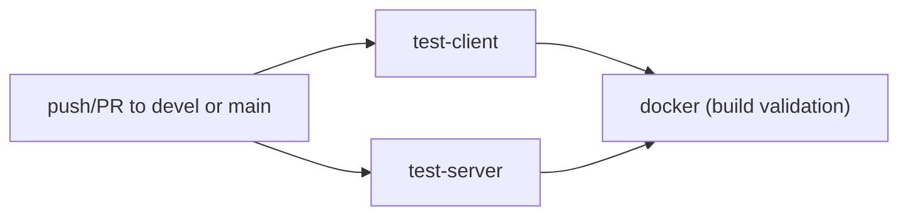

# CI/CD

[← Home](Home.md) · See also [Testing](Testing.md) · [Development](Development.md)

This repository's CI/CD, as checked in, consists of a GitHub Actions workflow that runs tests
and validates Docker builds on every push/PR.

## GitHub Actions (`.github/workflows/ci.yml`)



**Triggers:** `push` and `pull_request` on branches `devel` and `main`
(`.github/workflows/ci.yml:3-11`).

**Concurrency:** one run per `${{ github.workflow }}-${{ github.ref }}` group, with
`cancel-in-progress: true` — pushing again to the same branch/PR cancels the previous run.

**Permissions:** `contents: read` only.

### Job: `test-client`

Runs on `ubuntu-latest`.

1. `actions/checkout@v5`
2. `actions/setup-node@v5` with `node-version-file: .nvmrc` (pins Node to `22.23.4`), npm cache
   keyed on `src/client/package-lock.json`.
3. `working-directory: src/client` → `npm ci --legacy-peer-deps`
4. `working-directory: src/client` → `npm run test:coverage`

### Job: `test-server`

Same shape, `working-directory: src/server`, `npm ci` (no `--legacy-peer-deps` needed),
`npm run test:coverage`.

### Job: `docker`

`needs: [test-client, test-server]` — only runs if **both** test jobs pass.

1. Checkout.
2. `docker build -t ingenium_ui:${{ github.sha }} .` — the default
   `Dockerfile`.
3. `docker build -f Dockerfile-nginx-https -t ingenium_ui_nginx:${{ github.sha }} .` —
   the TLS/NGINX image.

**Observed scope:** this job only **builds** the two images (validates the Dockerfiles still
produce a working build) — it does not push, tag for release, or deploy them anywhere.
**Unknown / not documented:** any registry push, image retention, or deployment trigger beyond
this build-validation step within this repo's CI config.

## Local reproduction of CI

```sh
# test-client job
NODE_OPTIONS=--max-old-space-size=8192   # already set by the npm script itself
cd src/client && npm ci --legacy-peer-deps && npm run test:coverage

# test-server job
cd src/server && npm ci && npm run test:coverage

# docker job
docker build -t ingenium_ui:local .
docker build -f Dockerfile-nginx-https -t ingenium_ui_nginx:local .
```

## Related pages

- [Testing](Testing.md) — what `test:coverage` actually runs for each half.
- [Architecture](Architecture.md#deployment-topologies-observed-from-dockerfiles) — what each
  Dockerfile produces and how the resulting images relate to each other.
