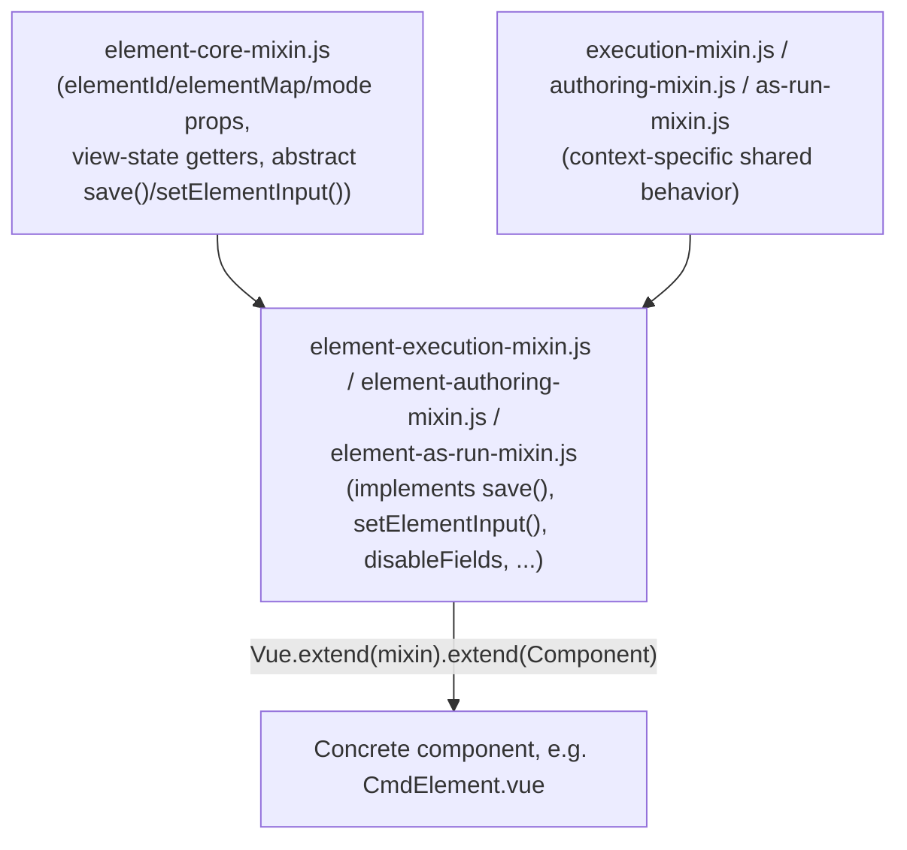

# Client (`src/client`)

[← Home](Home.md) · See also [Architecture](Architecture.md) · [API-Reference](API-Reference.md) · [Data-Flow](Data-Flow.md)

The client is a **Vue 2** application built with **webpack 5**, split into 11 independent SPA
bundles that share a large common component/store/mixin library. There is no single
"app.js" — each bundle is its own `new Vue({ el, router, store, render })` instantiation.

## Module bundles

Defined in `src/client/webpack.config.js:13-25`, each
entry mounts to a specific DOM element rendered by the matching server-side EJS shell
(`src/server/src/views/spa/*.ejs`, routed by
`src/server/src/routes/pages.js`):

| Bundle (webpack entry) | Source entry file | Mount element | Server route(s) |
|---|---|---|---|
| `dashboard` | `modules/dashboard/dashboard.js` | `#spa-dashboard` | `GET /` |
| `authoring` | `modules/authoring/authoring.js` | `#spa-authoring` | `/authoring/:procedureId/:version`, `/procedures/:procedureId`, `/procedures` |
| `execution` | `modules/execution/execution.js` | `#spa-execution` | `/execute/:venueId`, `/execute_spa/:venueId/:executionId` |
| `execute-as-run` | `modules/as-run/as-run.js` | (as-run root) | `/execute/as_run/:executionId` |
| `executions` | `modules/executions/executions.js` | — | `/executions` |
| `venue-detail` | `modules/venue-detail/venue-detail.js` | — | `/venues/:venueId` |
| `project-config` | `modules/project-config/project-config.js` | `#spa-project-config` | `/project_configuration/*` |
| `reporting` | `modules/reporting/reporting.js` | — | `/reporting` |
| `search` | `modules/search/search.js` | — | `/search` |
| `admin` | `modules/admin/admin.js` | `#spa-admin` | `/admin` and all `/admin/*` sub-routes |
| `header` | `modules/header/header.js` | `.up-header` | included via `partials/head.ejs` on (most) pages |

Each bundle's Vue Router uses `mode: 'history'`. Route lists are defined per entry file (e.g.
`authoring.js:128-144`, `admin.js:16-52`, `project-config.js:28-166` which nests dictionary
sub-routes with `props: (route) => ({...})` for `cmds`/`evrs`/`ehas`/`mil1553` tabs).

Authorization scaffolding (`@casl/vue` `abilitiesPlugin` +
`modules/common/abilities.js::defineAbilityFor(getUserScopes())`) is installed in every
bundle that needs it (dashboard, authoring, execution, project-config, ...), driven by the
`scopes` claim decoded from the JWT — see [Security](Security.md#client-side-authorization-casl).

## Shared store (`modules/common/store.js`)

Most bundles import the shared root Vuex store, which composes per-domain modules:

```js
// src/client/src/modules/common/store.js
new Vuex.Store({
    modules: {
        dashboard, comments, dictionaries, venueDetail, execution, executions,
        evr, cmd, runProcedure, cmdSse, eha, projectConfig, admin, message
    },
    strict: process.env.NODE_ENV !== 'production'
});
```

**Exception:** the `authoring` bundle does **not** import this shared store — it has its own
`modules/authoring/store.js`, because `authoring-store.js` (104 KB, the largest single file in
the client) owns the full procedure-editing state machine independently. Both stores register
the element-type sub-modules (`evr`, `cmd`, `cmdSse`, `eha`, `runProcedure`) since the same
element components are shown in both contexts.

`strict: true` outside production means **any state mutation outside a registered mutation
handler throws** during development and in the test suite — a useful guardrail when adding new
store logic.

## The element system (`modules/elements/`)

This is the core reusable abstraction of the app: a procedure is a tree of **elements**
(steps/sections/paragraphs), and the *same* Vue components render that tree in three different
contexts — **authoring**, **live execution**, and **as-run playback** — by swapping which mixin
each component is extended with, rather than duplicating the component per context.

### Element categories

- **`modules/elements/executable/`** — steps that do something at execution time: `cmd`,
  `cmd-file`, `cmd-scmf`, `cmd-sse`, `manual-input`, `manual-verification`, `manual-gds`, `wait`,
  `wait-eha`, `wait-evr`, `wait-dp`, `time-reference`, `environment`, `venue-config`,
  `get-venue-config`, `check-venue-config`, `update-venue-config`, `query-evr`, `verify-eha`,
  `graph-eha`, `1553` (MIL-STD-1553 bus), `custom_script`, `eip`, `list-dp`,
  `verification-item-status`. Each subfolder typically has an `*Element.vue` (the
  step body) and, where the step also appears in a tabular/compact view, an `*Entry.vue`. The
  aggregate export lives in `executable/index.js`.
- **`modules/elements/non-executable/`** — structural types: `section`, `paragraph`,
  `run-procedure` (embeds another procedure), `verification-item`. Aggregate export in
  `non-executable/index.js`.
- **Shared chrome** at the top of `modules/elements/`: `IngElement.vue` (the generic
  element wrapper: header, toolbar, comments/redline affordances — 57 KB, the largest single
  Vue component), `IngElementWrapper.vue`, `EntryWrapper.vue`, `IngWorkflow.vue` (renders the
  full nested tree), `IngRedline.vue`, `IngTag*.vue` (inline tag/reference UI),
  `DropPlaceHolder.vue` and `DynamicEntryActions.vue` (drag-and-drop authoring affordances),
  `ViewStateButtons.vue`, `DeleteTagButton.vue`.

### Mixin layering (`modules/elements/mixins/`)

Each SPA entry (`authoring.js`, `execution.js`, `as-run.js`) globally registers every element
component wrapped in a mode-specific mixin chain, e.g. in `authoring.js`:

```js
Vue.component('ing-element', Vue.extend(authoringNestableMixin).extend(IngElement));
Vue.component('cmd-element', Vue.extend(elementAuthoringMixin).extend(executable.CmdElement));
Vue.component('cmd-entry',   Vue.extend(entryAuthoringMixin).extend(executable.CmdEntry));
```

The mixins compose in layers (see
`src/client/src/modules/elements/mixins/element-execution-mixin.js`
for a concrete example):



`element-core-mixin.js` defines `save()` and `setElementInput()` as methods that `throw('You
must implement this method in a context-specific mixin')` — a deliberate abstract-base-class
pattern enforced at runtime rather than compile time. Concrete behavior differs sharply by
mode:
- **`element-execution-mixin.js`** — `save()` dispatches `saveElementInput`; exposes
  `saveRedlineInput`, `editElementInput`, `editElementArray` actions; `executed` reads from
  element state.
- **`element-as-run-mixin.js`** — `save()`/`setElementInput()` are no-ops (`return false`);
  `disableFields`/`canDisableExecuteField` are hard-coded `true` — as-run is a **read-only
  playback view** of a completed execution.
- **`element-authoring-mixin.js`** — not shown above verbatim, but by symmetry implements
  authoring-time persistence (procedure editing) rather than execution-time input.

The nestable mixins (`authoring-nestable-mixin.js`, `execution-nestable-mixin.js`,
`as-run-nestable-mixin.js`) are applied to the **container** components (`IngElement`,
`IngElementWrapper`, `EntryWrapper`) rather than individual step types, and own tree-level
concerns: fetching the step palette, drag-and-drop reordering
(`authoring-nestable-mixin.js::elementDrop`), and permission gating (`isAllowEdit`, gated on
`?update` query param + procedure lock ownership).

### Element type registry (`modules/common/elem_types.js`)

Pure functions that resolve a raw element object (`elem_type`, `step_type`, and for custom
steps `authoring_user_input.script_id`/`execution_user_input.script_id`) against the combined
built-in + custom step palette to answer "what component renders this?", "what's its display
name/path?", "what categories exist for the palette?". `augmentStepsWithElementMap()` normalizes
built-in step defs (`augmentStepWithBuiltInElementMap`) and custom-script defs
(`augmentStepWithCustomElementMap`, which synthesizes a `CUSTOM_SCRIPT` `step_type` and a
`scriptMeta` blob) into one shape consumers can treat uniformly.

## Shared component/utility library (`modules/common/`)

- **Vuex modules**: `store.js` (root composer), `comments-store.js`, `dictionaries-store.js`,
  `message-store.js` (global feedback/error modal state — see
  [Error-Handling](Error-Handling.md)).
- **Reusable components**: `IngTable.vue`, `IngDataEntry.vue`/`IngDataGrid.vue` (Excel/Google
  Sheets-compatible data entry grid — see below), `IngAutocomplete.vue`,
  `IngComment.vue`/`IngComments.vue`/`IngConversation(s).vue` (commenting system),
  `IngEditable.vue`/`IngEditableWithFroala.vue` (inline rich-text editing via Froala),
  `IngModal.vue`, `IngPopover.vue`/`IngDetailsPopover.vue`, `IngContextMenu.vue`,
  `IngSpinner.vue`/`SpinnerModal.vue`, `Paginator.vue`, `IngToggle.vue`/`SwitchSlider.vue`,
  `VenueActionLink.vue`/`VenueStatusDot.vue`, `FeedbackModal.vue`.
- **`side-panel/`** — the authoring/execution side panel tab set: `Outline.vue`,
  `StepPalette.vue`, `Comments.vue`, `Redline.vue`, `Status.vue`, `Validate*.vue`,
  `Search.vue`/`SearchResultCard.vue`, `Dictionaries.vue`, `Controls.vue`,
  `ParticipantsModal.vue`, `ElementOutline.vue`, assembled by `SidePanel.vue`.
- **`directives/`** — `DragAndDrop.js` (custom `v-drag-and-drop` directive backing the
  authoring canvas drag/drop) and `ContextMenu.js` (`v-click-outside`, used to close context
  menus/popovers).
- **`utils.js`** (34 KB) — grab-bag of shared helpers, notably the JWT-cookie readers used for
  client-side auth/authorization: `getJwt()` (reads the `access_token` cookie),
  `isLoggedIn()`, `getUsername()`, `getRoles()`, `getUserScopes()`, `isAdmin()` (all via
  `jwt_decode`, i.e. **decoding only, no signature check** — the client trusts the cookie was
  already verified server-side at login/renewal time).
- **`abilities.js`** — `defineAbilityFor(scopes)` builds a CASL `Ability` instance from the
  JWT's `scopes` claim (see [Security](Security.md#client-side-authorization-casl) for the
  full scope→permission table).
- **`elem_types.js`**, **`verification-conditions.js`**, **`hash-colors.js`**,
  **`tooltip-config.js`**, **`filters.js`**, **`froala-import.js`**, **`autoscroll.js`**.

### Data entry grid (`IngDataEntry.vue` / `IngDataGrid.vue` / `modules/common/grid/`)

`IngDataEntry.vue` renders a modal, Excel/Google Sheets-compatible data table (used by
`VerifyEhaElement`, `CustomScriptElement`, `EipElement`, etc. for tabular execution/authoring
input) on top of an Ingenium-owned grid abstraction, **not** a third-party grid library directly:

- **`IngDataGrid.vue`** — the only file that imports `tabulator-tables` (MIT-licensed; replaced
  the commercial Handsontable dependency). It exposes a small Ingenium-specific API
  (`getData`, `loadData`, `getDataAtCell`, `setDataAtCell`, `setCellClassName`,
  `clearCellClassNames`, `setCellSource`, `selectCell`, `getSelection`, `insertRow`, `removeRow`,
  `countRows`, `refresh`) and events (`before-change`/`after-change`, `after-create-row`,
  `after-remove-row`, `selection-change`, `context-menu-paste`) — no Tabulator type or object
  ever crosses this boundary, so the underlying grid library could be swapped again without
  touching `IngDataEntry.vue`. It also owns things Tabulator doesn't provide out of the box: a
  drag fill-handle, and a pointer-anchored right-click context menu (Tabulator's own popups are
  positioned in document coordinates, which is wrong once the grid is inside a
  `position: fixed` modal).
- **`grid/tsv.js`** — framework-free RFC4180-style TSV serialize/parse used for clipboard
  copy/paste, handling quoted tabs/newlines and CRLF/LF/CR line endings so paste from Excel or
  Google Sheets round-trips correctly.
- **`grid/grid-model.js`** — framework-free authoritative data model (row storage, selection,
  paste/fill/clear operations, per-cell CSS class and dropdown-source metadata) that
  `IngDataGrid.vue` keeps in sync with Tabulator's DOM state.
- **`grid/grid-constants.js`** — shared `GridColumnType`, `GridSource`, `ContextMenuItem`,
  `INVALID_CELL_CLASS` (`'orange-bg'`) constants used by both `IngDataGrid.vue` and
  `IngDataEntry.vue`.

`IngDataEntry.vue` itself owns all business logic and is unaware of Tabulator: column
derivation from `columnInfos` (`getTableColumns`), per-cell validation against the persisted
data shape (`validateCell` — this is what drives the orange "invalid value" highlight),
grid-row ↔️ persisted-object conversion (`toRowObj`, notably the `verification_values`
array special case), and cross-column sync rules (`syncColumnValues`, driven by a column's
`sync` config).

## API layer (`src/api/`)

One module per backend service, all built on a shared axios instance
(`src/client/src/api/transport.js`):

- `transport.js` — creates the shared `transport` axios instance, sets the default
  `Authorization: Bearer <jwt>` header from the cookie at load time, exposes
  `window.updateApiToken()` (called after token renewal), a **legacy params serializer**
  that reproduces axios 0.18 query-string encoding (dropping `null`/`undefined` params instead
  of serializing them as empty strings — a documented regression workaround for the axios
  upgrade), and a response interceptor that computes client/server clock drift
  (`ING_CLIENT_TIME_OFFSET_SECS` in `localStorage`) and stamps a `last_action` cookie used by
  session-expiry countdowns.
- `*-urls.js` (`core-urls.js`, `dict-urls.js`, `admin-urls.js`, `report-urls.js`,
  `search-url.js`) — pure URL-builder objects, namespaced by resource
  (e.g. `coreExecutionUrls.elements(executionId, elementId)`), all rooted at the
  `/core_server`, `/dict_server`, etc. prefixes proxied per [Architecture](Architecture.md).
- `authoring.js`, `execution.js`, `procedures.js`, `comments.js`, `dictionary.js`, `venue.js`,
  `admin.js`, `report.js`, `search.js`, `auth.js` — the actual request functions consumed by
  Vuex actions, each calling `transport` against the corresponding `*-urls.js` builder.

See [API-Reference](API-Reference.md#client-api-layer) for representative function signatures.

## Build configuration

- **`webpack.config.js`** — production/dev build. Injects `process.env` per-mode via
  `config/{dev,test,prod}.env.js` (`DefinePlugin`); provides `jQuery`/`$`/`Buffer`/`process`
  globally (`ProvidePlugin`) for legacy deps (Froala) that assume they're
  available; polyfills Node core modules removed in webpack 5 (`crypto`, `stream`, `vm`,
  `buffer`, `util`, `process`) via `resolve.fallback`; extracts all component CSS into one
  `main.css` via `MiniCssExtractPlugin` + a `splitChunks` cache group, while `.vue`-scoped
  styles are injected at runtime via `vue-style-loader` (**required** because the SPA page
  shells don't load `main.css` — see the comment block at
  `webpack.config.js:38-44`).
- **`webpack.test.js`** — parallel config used only by Karma (`karma-webpack`); no
  entry/output (karma-webpack supplies those per spec bundle), CSS always injected at runtime,
  `url()` left unresolved so fonts/images don't need to be emitted for tests.
- **`.babelrc`** — `@babel/preset-env` (targets modern evergreen browsers only — no IE 11,
  `corejs: 3` polyfills via `useBuiltIns: "usage"`), plus `babel-plugin-lodash`,
  `@babel/plugin-proposal-optional-chaining`, `@babel/plugin-proposal-nullish-coalescing-operator`.
  A `test` env block adds `babel-plugin-istanbul` for coverage instrumentation
  (excluding `test/`, `*.spec.js`, `node_modules`). IE 11 was dropped because `core-js` was
  silently replacing the global `Promise` with one missing `Promise.prototype.finally`
  whenever an IE 11 target was declared (no call site used `.finally`, so babel never injected
  it) — this broke `IngDataGrid.vue`'s grid library at init. Do not re-add `ie >= 11` without
  also adding an explicit `Promise.prototype.finally` polyfill.

## Related pages

- [API-Reference](API-Reference.md#client-api-layer) — function-level API documentation.
- [Data-Flow](Data-Flow.md) — how authoring edits and execution updates actually move through
  this store/API layer.
- [Security](Security.md#client-side-authorization-casl) — CASL ability rules in full.
- [Testing](Testing.md#client-tests) — Karma/Jasmine setup for this half of the repo.
- [Extending](Extending.md#adding-a-new-element-step-type) — how to add a new step type using
  this mixin system.
