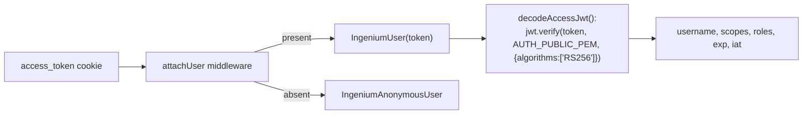

# Security

[← Home](Home.md) · See also [Server](Server.md) · [Client](Client.md) · [Data-Flow](Data-Flow.md)

This page documents security-relevant mechanisms **as implemented**. It does not claim the
system is secure overall — only describes what exists.

## Identity model: JWT, no database

There is no user table or session store anywhere in this repository. The server's notion of
"the current user" (`IngeniumUser` /
`src/server/src/lib/ingeniumUser.js`) is a thin wrapper
around a single JWT string, always re-derived per request from the `access_token` cookie
(`middleware/auth.js::attachUser`). If the cookie is absent, `req.user` is an
`IngeniumAnonymousUser` whose `isAuthenticated()` always returns `false`.

## Login / JWT issuance

`POST /login` (`src/server/src/routes/login.js`) does
**not** issue the JWT itself — it forwards the username/password to the external Auth service
(`AUTH_LOGIN_URL`) using HTTP Basic auth plus an `X-AUTH-METHOD` header (`password` or `rsa`,
from `AUTH_METHOD` config), and trusts whatever `access_token` the Auth service returns. The
server's only responsibilities are: (a) never leak the raw upstream error on failure (falls
back to a generic message), and (b) set three cookies (`access_token`,
`access_token_timeout`, `expiration_date`) with **no explicit `httpOnly`/`secure`/`sameSite`
options** on `res.cookie()` calls in `login.js` — these use Express's cookie defaults. Compare
this to the CSRF cookie, which explicitly sets `sameSite: 'strict'` and conditional `secure`
(see below) — the auth cookies do not share those explicit protections in the code as written.

## JWT verification

Verification happens in exactly one place: `IngeniumUser.decodeAccessJwt()`
(`lib/ingeniumUser.js:18-25`), using `jwt.verify(this.access, config.AUTH_PUBLIC_PEM, {
algorithms: config.AUTH_SECRET_KEY_ALGORITHMS })` where `AUTH_SECRET_KEY_ALGORITHMS` is
hard-coded to `['RS256']` (i.e. asymmetric signature verification against a public key — the
server never holds the private signing key). This is called (directly or via another
`IngeniumUser` getter) by:
- `middleware/session.js::checkSessionExpiration` on every request for an authenticated user —
  `jwt.TokenExpiredError` or `JsonWebTokenError` triggers an automatic logout
  (`logoutRequest`), not just a 401.
- `routes/login.js::renewTokenRequestHandler` (`GET /renew`) — verifies the **new** token
  returned by the Auth service's refresh endpoint before trusting it.
- Any route handler indirectly, via `req.user.getToken()`/`getUsername()`/etc.

**Client-side JWT handling is verification-free by design.** `src/client/src/modules/common/utils.js`
(`getJwt`, `getUsername`, `getRoles`, `getUserScopes`, `isAdmin`, `isLoggedIn`) all use
`jwt_decode` (the `jwt-decode` npm package), which **only base64-decodes the payload** — it does
not check the signature. This is safe *as a UI convenience* only because the server independently
verifies the signature on every request that matters; the client-side decode is used purely to
drive UI state (menu visibility, CASL abilities, expiration display), not to authorize API
calls.

## Authorization

Two independent, **not obviously reconciled**, authorization mechanisms exist.

### Server-side scopes

Carried in the JWT's `scopes` claim, read via `IngeniumUser.getPermissions()`.
`IngeniumUser.isAdmin()` checks for the literal scope value `'admin'`. Nothing in
`src/server/src/routes/*.js` was observed to gate individual routes on specific scopes beyond
`loginRequired`'s authenticated-or-not check — route-level scope enforcement, if any, appears to
happen in the downstream microservices (Core/Auth/etc.), not in this server.

### Client-side authorization (CASL)

`src/client/src/modules/common/abilities.js::defineAbilityFor(scopes)` builds a CASL `Ability`
from the same `scopes` claim, mapping scope values to subject-level permissions:

| JWT scope value | Grants |
|---|---|
| `admin` | `read/update/create/delete` on `Admin` |
| `basic` | `read` on `Execution`, `read` on `Authoring`, full CRUD on `Basic` |
| `config_mgmt` | full CRUD on `Configuration_Management` |
| `imcm` | full CRUD on `IMCM` |
| `test_lead` | full CRUD on `Test_Lead` |
| `author` | full CRUD on `Procedure` |
| `execute:wsts` | full CRUD on `` Execution:WSTS#<venue_group_id> `` |
| `execute:testbed` | full CRUD on `` Execution:Testbed#<venue_group_id> `` |
| `execute:sit` | full CRUD on `` Execution:ATLO#<venue_group_id> `` |
| `execute:other` | full CRUD on `` Execution:Other#<venue_group_id> `` |

This is installed via `Vue.use(abilitiesPlugin, abilities)` in every bundle that imports it
(dashboard, authoring, execution, project-config, ...) and used in templates/components (via
the injected `$can`) to show/hide UI — **this is a UI convenience, not a security boundary**;
nothing prevents a client from calling an API directly regardless of what CASL permits in the
UI. Actual enforcement, if any, is the downstream services' responsibility.

**Unknown / not documented:** whether/how the downstream Core/Auth/Dictionary/etc. services
enforce these scopes server-side — those services are separate repositories, out of scope here.

## CSRF protection

`middleware/csrf.js` wraps the `csrf-csrf` package's double-submit-cookie implementation:

- Cookie name: `csrf_token`. Options: `sameSite: 'strict'`, `secure: NODE_ENV === 'production'`,
  `httpOnly: false` (must be readable by client JS to attach to AJAX requests — mirrors
  Django's non-httpOnly `csrftoken` cookie).
- Session identifier: the authenticated username, or the literal string `'anonymous'` — meaning
  CSRF tokens are **not** strictly per-session for unauthenticated users (all anonymous
  visitors share the "anonymous" identifier for token-binding purposes). This matters because
  the login form itself is CSRF-protected (`app.js` applies `doubleCsrfProtection` globally,
  before the public login routes).
- Token is read from `req.body._csrf` (HTML form field) or the `X-CSRF-Token` header (AJAX).
- On failure, `csrfErrorHandler` renders `403.ejs` rather than a generic 500.
- `CSRF_SECRET` (used to sign tokens) falls back to `SECRET_KEY`, then to the literal
  `'change-me-in-production'` if neither is set — **must be overridden in any real deployment**;
  this is flagged directly in the source comment.

## Credential-safe logging

`lib/httpClient.js` deliberately avoids logging anything that could leak credentials:
- `redactUrl(url)` strips query strings/fragments before logging, keeping only
  `protocol//host/path`.
- On upstream request failure, the raw axios error (whose `.config`/`.request` carry
  `Authorization` headers and POST bodies, potentially including passwords) is **never**
  propagated — a new, minimal `Error` is constructed instead
  (`Upstream request to <redacted-url> failed: <code or message>`).
- The app's top-level error handler (`app.js:73-80`) similarly logs only
  `err.message`/`err.stack`, never the raw `err` object, with an explicit comment warning that
  axios/HTTP errors can carry Authorization headers and POST bodies on `err.config`/`err.request`.

## TLS

- Production HTTPS termination happens at the NGINX layer (`ingenium-https.conf`), not in the
  Express app — TLS certs/ciphers/protocols (`TLSv1.2`/`TLSv1.3`, an explicit strong cipher
  list, HSTS header) are all configured there, not in `src/server`.
- `VERIFY_REQUESTS_SSL` config exists in `src/server/src/config/index.js` (parsed from
  `VERIFY_REQUESTS_SSL` env var) but was **not observed to be wired into `httpClient.js`'s axios
  calls** — verify current behavior before assuming this variable actually controls TLS
  certificate verification for server-to-backend calls.

## Related pages

- [Data-Flow](Data-Flow.md#login) — the concrete login request/response sequence.
- [Server](Server.md#middleware-pipeline-srcappjs) — where auth/CSRF sit in the request pipeline.
- [Configuration](Configuration.md#server-srcserver) — `CSRF_SECRET`, `PUBLIC_PEM`, `AUTH_METHOD`.
